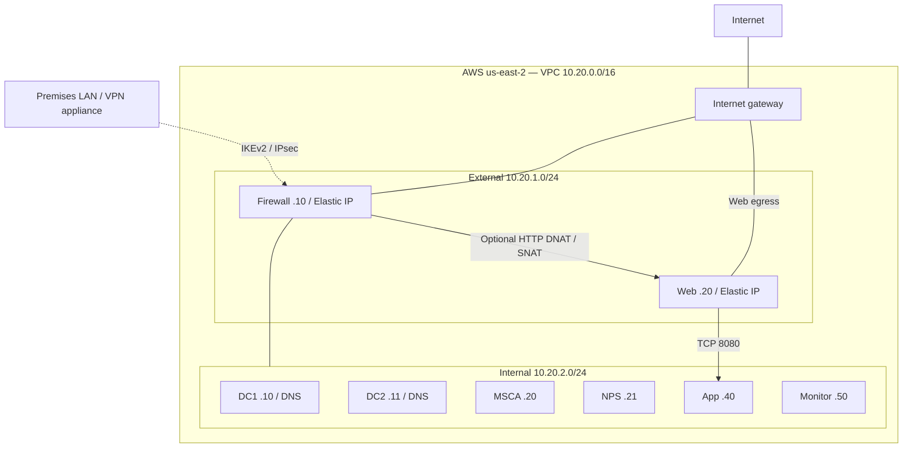

# Small cloud environment

AWS infrastructure for an organization in Ann Arbor, Michigan, with approximately 20 staff and 150–200 users. The design connects the premises to a cloud virtual firewall over an IKEv2/IPsec site-to-site VPN and separates external Linux workloads from internal directory, certificate, authentication and application services.

**Status: Configuration validated; no AWS resources deployed.** See `VALIDATION.txt` for verification and limitations. Windows role features are installed by EC2 user data if launched. Domain promotion, domain joining, CA initialization and NPS registration use the included operator-driven PowerShell script. Passwords and shared secrets stay outside Terraform.

## Architecture and capacity

| Component | Design |
| --- | --- |
| Region / default AZ | `us-east-2` (US East, Ohio) / `us-east-2a` |
| VPC | `10.20.0.0/16` |
| External subnet | `10.20.1.0/24`: firewall and web |
| Internal subnet | `10.20.2.0/24`: DC1, DC2, MSCA, NPS, app and monitor |
| External default route | Internet gateway |
| Internal default route | Firewall ENI; source/destination checking disabled |
| Optional premises route | Both subnet route tables send the configured remote LAN to the firewall ENI |
| Public addresses | Firewall and external web each have an Elastic IP |

The region is a nearby hosting choice for Ann Arbor. Actual ISP-to-region latency must be measured; no latency guarantee or lowest-cost claim is made. The single-AZ topology keeps the implementation small, with explicit availability limits below.

| Server | Subnet / private IP | OS | Instance | vCPU / RAM | Encrypted gp3 disk | Role |
| --- | --- | --- | --- | --- | --- | --- |
| firewall | External / `10.20.1.10` | Ubuntu 24.04 | `t3.medium` | 2 / 4 GiB | 30 GiB | Firewall, internal NAT, strongSwan IPsec |
| web | External / `10.20.1.20` | Ubuntu 24.04 | `t3.medium` | 2 / 4 GiB | 30 GiB | nginx, reverse proxy, PKI publication directory |
| app | Internal / `10.20.2.40` | Ubuntu 24.04 | `t3.medium` | 2 / 4 GiB | 30 GiB | Unprivileged reference HTTP application |
| monitor | Internal / `10.20.2.50` | Ubuntu 24.04 | `t3.medium` | 2 / 4 GiB | 30 GiB | Prometheus and Linux host metrics |
| dc1 | Internal / `10.20.2.10` | Windows Server 2022 | `c6i.xlarge` | 4 / 8 GiB | 60 GiB | First AD DS domain controller / DNS |
| dc2 | Internal / `10.20.2.11` | Windows Server 2022 | `c6i.xlarge` | 4 / 8 GiB | 60 GiB | Second AD DS domain controller / DNS |
| msca | Internal / `10.20.2.20` | Windows Server 2022 | `c6i.xlarge` | 4 / 8 GiB | 60 GiB | Microsoft Certificate Authority, AD CS |
| nps | Internal / `10.20.2.21` | Windows Server 2022 | `c6i.xlarge` | 4 / 8 GiB | 60 GiB | Network Policy Server, RADIUS |

Total: 24 vCPUs, 48 GiB RAM, 360 GiB encrypted root storage. All four Windows systems are internal. Linux is split exactly two external and two internal. RAM is selected by instance type; storage is explicitly configured.



## Files and local validation

- `main.tf`: network, IAM, security groups, eight instances, outputs, Linux service configuration and Windows role-feature bootstrap.
- `firewall-init.sh`: persistent firewall/NAT and optional IPsec template.
- `windows-roles.ps1`: secure, operator-driven domain/CA/NPS configuration.
- `terraform.tfvars.example`: safe settings; put real private settings in ignored `terraform.tfvars`.
- `tests/architecture.tftest.hcl`: mocked, plan-only tests.
- `.terraform.lock.hcl`: pinned provider checksums; commit this file.
- `.gitignore`, `.gitattributes`: exclude runtime/secret files and preserve script line endings.
- `VALIDATION.txt`: check results and unverified behavior.

Install [Terraform](https://developer.hashicorp.com/terraform/install) 1.14 or later below 2.0. AWS provider 6.22.0 is pinned. In the project directory:

```powershell
terraform init -backend=false -input=false
terraform fmt -check -recursive
terraform validate
terraform test
```

Initial provider installation needs registry access. Subsequent local checks use mocks without AWS credentials or infrastructure creation. Tests cover counts, sizes, storage, exact subnet placement, Windows role features, VPN routing, service rules, encryption, IMDSv2 and input rejection. Mock AMI IDs, account IDs and peer addresses are synthetic. [Terraform provider mocking](https://developer.hashicorp.com/terraform/language/tests/mocking).

An authorized AWS-backed `terraform plan -input=false` can resolve public AMIs and inspect proposed changes without launching infrastructure. Launching resources is a separate, billable operation requiring an approved change window. This repository contains no automatic deployment workflow.

## Routing and security

Internal internet traffic goes to the single-ENI firewall. The appliance loads a default-drop policy before enabling forwarding, allows routed HTTP/HTTPS egress for updates/management, and applies NAT. IPv6 is not provisioned and is blocked on the appliance. [AWS NAT instance requirements](https://docs.aws.amazon.com/vpc/latest/userguide/work-with-nat-instances.html).

The external web VM uses its own public IP for package downloads and SSM over the internet gateway. Its security group accepts HTTP only from the firewall private IP and, when VPN is enabled, from the premises CIDR. Its Elastic IP has no direct public HTTP rule. Web outbound internet traffic bypasses the NAT firewall, an explicit property of the external subnet. Public SSH and RDP remain closed everywhere.

Public HTTP publication is off by default. Allowlisted client CIDRs can reach firewall TCP 80, which DNATs to web and SNATs to the firewall private IP for a symmetric return path. nginx therefore sees the firewall address on these requests. The reference application has no TLS or end-user authentication; production application publishing needs approved DNS, HTTPS and access controls before handling confidential information. `/pki/` provides a directory for signed public CA certificates and CRLs; no PKI content is prepopulated.

| Destination | Permitted services | Sources |
| --- | --- | --- |
| Firewall | IKE UDP 500/4500 | Exact VPN peer public IP |
| Firewall / Linux exporters | TCP 9100 | Monitor private IP |
| Web | TCP 80 | Firewall private IP; premises CIDR when VPN enabled |
| App | TCP 8080 | Web and monitor private IPs |
| DC1/DC2 | DNS, Kerberos, LDAP/LDAPS, SMB, password change, global catalog, RPC, ADWS, NTP | Internal subnet; premises CIDR when VPN enabled |
| MSCA | TCP 135 and RPC TCP 49152–65535 | Internal subnet; premises CIDR when VPN enabled |
| NPS | RADIUS UDP 1812/1813 | Internal subnet; premises CIDR when VPN enabled |
| Administration | RDP, SSH, Prometheus 9090, diagnostic ICMP on appropriate hosts | Premises CIDR when VPN enabled; SSM remains preferred |

Windows role rules are created in both AWS security groups and the Windows host firewall. These rules provide reachability, not domain membership or service authorization. Narrow network ranges to actual managed clients/devices in operational hardening. Same-VPC traffic follows the AWS local route and is controlled by destination security groups; it is not centrally inspected.

Every instance requires IMDSv2 and encrypted gp3 storage. SSM management uses outbound HTTPS. Firewall and workload roles are separate; management-channel policies do not grant general Parameter Store reads. Only the firewall may read the named VPN PSK parameter. Human administrator permissions, secure state storage, patch policy, backups and log retention must be established for actual operation.

## Site-to-site VPN

The premises team supplies a static public peer and a non-overlapping LAN CIDR. The optional `vpn` object configures strongSwan on the existing firewall; it does not add a managed AWS VPN or transit gateway.

| Parameter | Value |
| --- | --- |
| Protocol / authentication | IKEv2 / PSK / tunnel mode |
| IKE | AES-256, SHA-256, DH group 14 |
| ESP | AES-256, SHA-256, PFS group 14 |
| AWS protected network | `10.20.0.0/16`, covering both subnets |
| Premises network | Configured RFC1918 /16 or smaller, no overlap with `10.20.0.0/16` |
| Identities | Firewall EIP and premises peer public IP |
| Transport | UDP 500 and forced ESP-in-UDP 4500 |
| Liveness | 30-second DPD; trap/restart; one-hour CHILD rekey |

Create a randomly generated 64-hex-character PSK outside Terraform as an SSM SecureString in `us-east-2`. Supply only the parameter ARN. If a customer-managed KMS key is used, supply its ARN and grant the required key-policy access. Never commit the value or other credentials. The firewall reads it at runtime, writes a root-only strongSwan file and refreshes/retries every five minutes. Its IAM access is limited to that parameter and optional KMS key through SSM.

Both subnet route tables send premises traffic to the firewall ENI. Host rules require IPsec policy matches, deny cleartext fallback, permit encrypted established replies and exempt protected traffic from NAT. On the premises appliance, use the firewall EIP as peer, reverse the protected selectors, match proposals/PSK, allow UDP 500/4500, add NAT exemptions, and route `10.20.0.0/16` through the tunnel. Any separate LAN default gateway needs the corresponding return route. Configure premises clients to use DC1/DC2 for the AD namespace once operational. [strongSwan configuration](https://docs.strongswan.org/docs/latest/swanctl/swanctlConf.html), [forwarding and NAT](https://docs.strongswan.org/docs/latest/howtos/forwarding.html).

## Windows configuration sequence

EC2 user data installs AD DS/DNS on DC1/DC2, AD CS on MSCA and NPAS on NPS. It records status in `C:\ProgramData\School\bootstrap-status.json`. Restart if required. Installing features does not create a functioning directory, CA or RADIUS policy.

Copy `windows-roles.ps1` to each matching server using an approved administrative channel. Run elevated **Windows PowerShell 5.1**. Replace `ad.school.example` with a subdomain the organization controls. The helper checks the expected private IP and action/role pairing. Passwords are entered using secure prompts; no domain password, DSRM password, CA key or RADIUS secret is stored by Terraform.

1. On **DC1**, run the command below. The first run renames the host `SC-DC1`; restart and rerun. After forest creation, restart again, set DNS forwarding and check directory/DNS health before continuing.

```powershell
.\windows-roles.ps1 -ServerRole DC1 -Action PromotePrimary -DomainName ad.school.example -NetbiosName SCHOOL
# After promotion and restart, on DC1:
Set-DnsServerForwarder -IPAddress 10.20.0.2
Get-ADDomain
dcdiag /test:dns
```

2. On **DC2**, run, restart if renamed, then rerun. Supply a domain administrator authorized to add a DC and a unique DSRM password. Restart after promotion, set its forwarder and check replication.

```powershell
.\windows-roles.ps1 -ServerRole DC2 -Action PromoteSecondary -DomainName ad.school.example
# After promotion and restart, on DC2:
Set-DnsServerForwarder -IPAddress 10.20.0.2
repadmin /replsummary
```

3. On **MSCA** and **NPS**, run the matching JoinMember action. Restart after hostname change, rerun to join, then restart again. Member DNS is set to DC1/DC2.

```powershell
# On MSCA:
.\windows-roles.ps1 -ServerRole MSCA -Action JoinMember -DomainName ad.school.example
# On NPS:
.\windows-roles.ps1 -ServerRole NPS -Action JoinMember -DomainName ad.school.example
```

4. On **MSCA**, run as an elevated domain account with enterprise CA installation permissions. The helper initializes a dedicated online Enterprise Root CA with RSA-3072, SHA-256 and ten-year CA validity. Before issuing operational certificates, configure AIA/CDP publication, approved certificate templates and enrollment permissions. Publish signed CA certificates and CRLs to web's `/var/www/html/pki`, establish a stable PKI DNS name and test revocation retrieval from premises clients. CA database/key backups, publication jobs and DNS records require operational setup. A single online root CA has less isolation than an offline-root/issuing-CA hierarchy.

```powershell
.\windows-roles.ps1 -ServerRole MSCA -Action ConfigureCA -DomainName ad.school.example -CACommonName SmallCloud-RootCA
```

5. On **NPS**, run as an elevated domain account authorized to register it. Then use `nps.msc` to add the actual switches/APs/firewall as RADIUS clients by exact private IP, enter unique shared secrets securely, obtain an NPS server certificate from MSCA, and configure the approved EAP method, AD groups and network policies. Validate trust, names, renewal and revocation. Test an allowed and a denied identity/device before enabling organization-wide authentication. No broad allow-all network policy or hardcoded client secret is created.

```powershell
.\windows-roles.ps1 -ServerRole NPS -Action RegisterNPS -DomainName ad.school.example
Get-Service IAS
```

References: [CA installation](https://learn.microsoft.com/en-us/windows-server/networking/core-network-guide/cncg/server-certs/install-the-certification-authority), [NPS registration](https://learn.microsoft.com/en-us/windows-server/networking/technologies/nps/nps-manage-register), [NPS certificates](https://learn.microsoft.com/en-us/windows-server/networking/technologies/nps/nps-manage-certificates), [Windows service ports](https://learn.microsoft.com/en-us/troubleshoot/windows-server/networking/service-overview-and-network-port-requirements).

## Operational verification

For an authorized deployment, allow first-boot configuration to finish; EC2 creation does not guarantee service readiness. Linux package commands retry for approximately 15 minutes each. Check cloud-init logs, Windows bootstrap status and SSM registration.

- Firewall: inspect `systemctl status school-firewall`, `iptables -S`, and, if enabled, `swanctl --list-sas` and `ip xfrm policy`. Test permitted traffic, denial and encrypted return traffic in both directions.
- Web: `curl http://127.0.0.1/` and `curl http://127.0.0.1/api/health`. Monitor: `curl http://10.20.2.40:8080/health`.
- Prometheus: verify all four Linux exporters are up. Access TCP 9090 through SSM forwarding or the VPN; it is not published publicly. Windows exporters and alert delivery are not installed.
- Windows: verify DNS, replication, member secure channels, CA issuance/revocation and NPS positive/negative tests after configuration.
- Publication: verify approved client access through the firewall EIP and denied direct public HTTP to the web EIP.

Example SSM forwarding after replacing the monitor instance ID:

```powershell
aws ssm start-session --region us-east-2 --target i-REPLACE_WITH_MONITOR_ID --document-name AWS-StartPortForwardingSession --parameters '{"portNumber":["9090"],"localPortNumber":["9090"]}'
```

## Source control

The canonical repository is [lucham9/small-cloud-environment](https://github.com/lucham9/small-cloud-environment).

```powershell
git clone https://github.com/lucham9/small-cloud-environment.git
cd small-cloud-environment
terraform init -backend=false -input=false
terraform validate
terraform test
```

Keep the dependency lock file in version control. Review changes before pushing. Exclude provider caches, actual variable files, state, saved plans, private keys and credentials; the supplied `.gitignore` covers these categories. Source publication does not provision AWS infrastructure.

## Availability, cost and scope

This is a single-AZ design with one firewall and one VPN endpoint. Two DCs protect against an individual DC failure, not AZ failure. Firewall failure interrupts site connectivity and internal egress; web outbound egress uses its own public path. CA, NPS, web, app and monitor are each single-instance services. Protected backups, central logging, multi-AZ failover and recovery procedures require additional implementation.

The app is a reference endpoint, not an organizational business system. Actual AD namespace/OU/group design, certificate policy, NPS client/policy definitions and premises configuration need organization-specific inputs. These limitations are explicit.

A full launch needs 24 available standard On-Demand vCPUs in `us-east-2`; planning does not guarantee quota or capacity. Actual operation incurs compute, storage, two public IPv4 addresses and applicable transfer charges. T3 uses standard CPU credits. No managed NAT gateway or AWS managed VPN is added. No AWS resources were launched or quota increase requested. Use an encrypted, access-controlled state backend for operational use; none is provisioned here.
